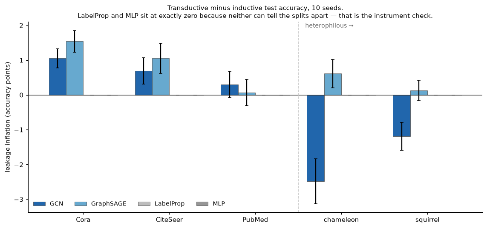
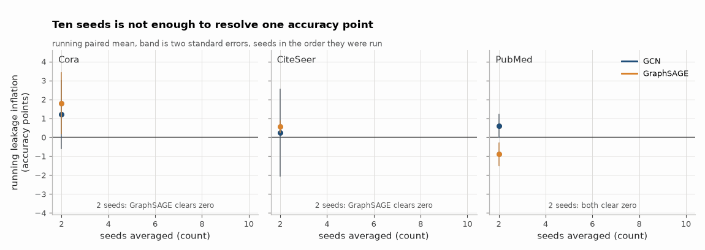
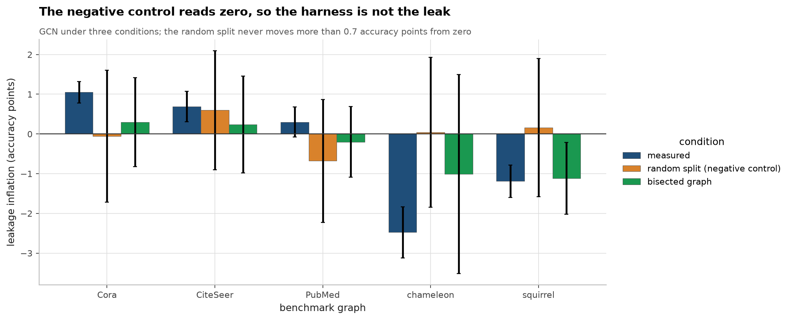
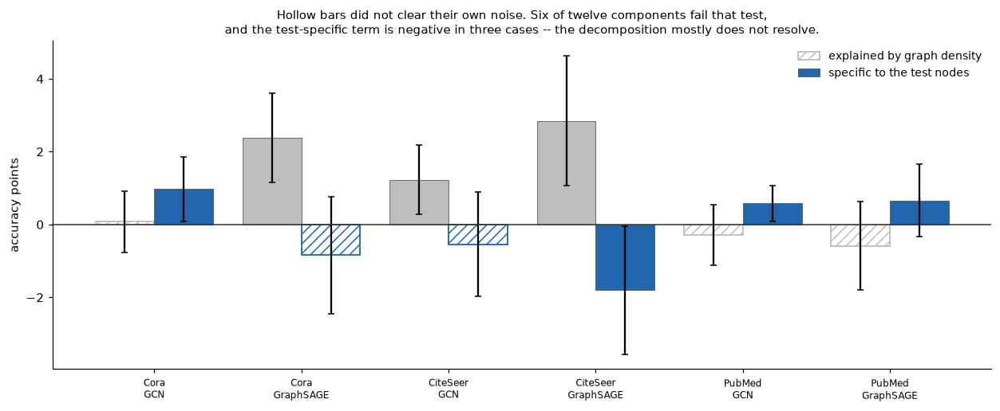
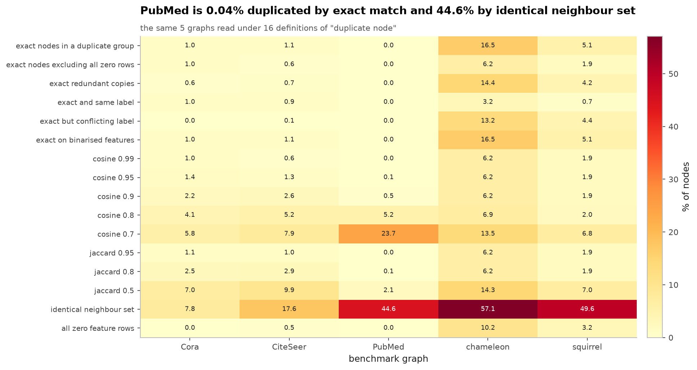
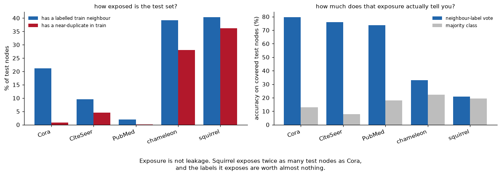

# LeakGraph

How much accuracy does transductive evaluation add on standard GNN node-classification benchmarks, and where does it come from?

---

## Abstract

Transductive node classification tests a model on nodes that were already in
the graph it trained on. The usual worry is that this leaks. I wanted to know how
big that leak is, so I measured it on five benchmarks and four models under one
protocol. The splits, seeds, initialisation and epoch budget are all the same.
The only thing that changes is whether the test nodes existed in the training
graph. I take the difference per seed and then average it, so shared
initialisation noise cancels.

Inflation does show up on the homophilous citation graphs, but it stays small,
reaching at most 1.5 accuracy points, on Cora with GraphSAGE. On the two
heterophilous graphs it goes the other way. There GCN *loses* 2.5 points to the
transductive split. LabelProp and MLP read exactly zero everywhere. That only
checks the instrument, since neither model can tell the two splits apart.

Exposure and leakage turn out to be different things. Squirrel exposes 40% of
its test nodes to a labelled training neighbour against Cora's 21%, and it still
inflates less. That's because a vote over those labels scores 21% there against
a 19% majority baseline. On Cora the same vote gets 80% against 13%. I also tried
to split inflation into a density term and a test-specific term. That mostly
fails to resolve, and I report it as a failure.

Here's what the repo adds. (i) One harness that measures duplicate, feature-label
and neighbourhood-label leakage on the same splits with the same seeds. (ii) A
headline metric, leakage inflation, that you can compare across datasets and
models. (iii) Negative and density-matched controls, including a random split
that reads zero. (iv) Evidence that the duplicate rate is mostly a choice of
definition. On PubMed it ranges from 0.04% to 45% depending on which one you use.

---

## 1. Scope: this is tooling, not a discovery

Everything I measure here is already documented in the literature. I didn't
discover any of it. What I did was build one harness that measures all of it on
the same splits and seeds under one protocol. I added a headline metric so the
cost can be compared across datasets and models, and I wrote a test suite for the
instrument itself. Think of it as a measuring device and a replication. It
doesn't make a new claim.

See [Prior work](#11-prior-work) for what was already known. I checked every
source there before citing it.

## 2. The headline number
On the homophilous citation graphs inflation is real, and it's small. I measured
1.5 accuracy points at most, on Cora with GraphSAGE. On the heterophilous pair
the sign flips. GCN *loses* 2.5 points on chameleon and 1.2 on squirrel by
training on a graph that already contains the test nodes. MLP and LabelProp read
exactly 0.0 in every cell. That's just the instrument check, since neither model
can tell the two arms apart.

*Leakage inflation on the three citation graphs, one seed added at a time. The band is two standard errors. It takes most of the ten seeds before the mean settles anywhere you'd want to quote it.*

Full detail in [notes/METHODS.md](notes/METHODS.md#2-the-headline-number).
### What I actually found, including the parts that argue against the premise
I built this expecting transductive evaluation to buy the GNNs a visible amount
of accuracy. Mostly it doesn't. Only five of the ten GNN cells resolve at two
standard errors. Even then, no resolved reading exceeds 2.5 accuracy points in
either direction. PubMed shows nothing at all for either GNN, 0.3 and 0.1 points.
And re-running everything on ten random splits leaves not one of the ten cells
resolved.

Full detail in [notes/METHODS.md](notes/METHODS.md#what-i-actually-found-including-the-parts-that-argue-against-the-premise).
## 3. What the number means
An accuracy gap doesn't mean much by itself, so I bound it with two baselines.
On Cora an MLP that never touches the graph already scores 56.9% against the
inductive GCN's 80.3%. So most of that accuracy was never graph learning. The
second baseline is a majority vote over a test node's training-set neighbours,
with no features and no training at all. It scores 79.6% on the 21% of Cora test
nodes that have such a neighbour. For comparison, the GCN scores 86.1% on that
same subset.

Full detail in [notes/METHODS.md](notes/METHODS.md#3-what-the-number-means).
## 4. Is the gap actually leakage?
The random split is my negative control. It has no temporal or structural
reason to leak, so a non-zero reading there would mean the harness is broken.
Nothing in it resolves.

A stronger check is a third arm. It removes the same *number* of nodes from the
unlabelled pool and leaves the test set alone. That splits the gap into the cost
of a smaller training graph and the part that's specific to the test nodes. For
GraphSAGE the smaller-graph term alone is 2.4 points on Cora and 2.8 on CiteSeer.
Both are larger than the total inflation, so almost none of that gap is leakage.
Cora GCN is the one cell where inflation survives the control roughly intact. It
reads 1.0 point total, 0.1 of it density, and a resolved test-specific 1.0.

Full detail in [notes/METHODS.md](notes/METHODS.md#4-is-the-gap-actually-leakage).
### Recovering the control where the split leaves no pool
You can make a pool of unlabelled nodes out of the test set itself. I reserve
half of it. Those nodes keep their features and edges, but their labels are never
used and they're never scored. That lets me build the decomposition on chameleon
and squirrel, where the geom-gcn splits label every node and leave no pool at
all. Neither component resolves on either dataset, with chameleon GCN reading
-0.5 density and -0.5 test-specific and squirrel GCN -0.5 and -0.7. So ten seeds
on a halved test set just can't tell.

Full detail in [notes/METHODS.md](notes/METHODS.md#recovering-the-control-where-the-split-leaves-no-pool).
### A second split scheme
The other option is to stop using the shipped splits. I drew ten random
Planetoid-style splits per dataset, with 20 labels per class. They leave an
unlabelled pool everywhere, chameleon and squirrel included. Under them not one
of the ten GNN inflation cells resolves, and the two negative GCN readings
vanish. Here chameleon moves from -2.5 to 0.0 and squirrel from -1.2 to 0.2. The
error bars are roughly double the headline table's. That's because they include
the split variance that a single public split can't show.

Full detail in [notes/METHODS.md](notes/METHODS.md#a-second-split-scheme).
## 5. Decomposing by duplicates
Adding test nodes does two things at once. It makes the graph denser, which
helps any node, and it exposes the test nodes' own neighbourhoods. If I score
only the test nodes that have no near-duplicate twin in training, it moves
inflation by at most 0.8 points anywhere. That includes squirrel, and squirrel
has 1,580 straddling pairs. So there are plenty of duplicates, but they add
little to *this* gap. The density half of the split isn't clean either, with
seven of its twelve GNN components clearing two standard errors. The
test-specific term also comes out negative in three of the six cells.

Full detail in [notes/METHODS.md](notes/METHODS.md#5-decomposing-by-duplicates).
## 6. The detectors
"Duplicate node" has no single meaning, and which one you pick dominates the
answer. PubMed is 0.04% duplicated under exact feature match and 44.6%
duplicated under identical neighbour set. So any headline duplicate figure is a
threshold decision before it's a measurement. The detectors also pull exposure
apart from leakage. Squirrel exposes 40% of its test nodes to a labelled
training neighbour against Cora's 21%, and it still inflates less. That's
because a vote over those labels scores 21% there against a 19% majority
baseline. The same vote on Cora scores 80% against 13%.

Full detail in [notes/METHODS.md](notes/METHODS.md#6-the-detectors).
### Duplicate and near-duplicate nodes
<!--BEGIN:duplicates-->

| dataset | nodes | exact duplicate nodes | all-zero feature rows | near-dup pairs | cutoff | straddling pairs | test nodes with a train twin |
|---|---|---|---|---|---|---|---|
| Cora | 2708 | 27 (1.0%) | 0 | 440 | 0.474 | 10 | 8 / 1000 (0.8%) |
| CiteSeer | 3327 | 35 (1.1%) | 15 | 2790 | 0.292 | 51 | 45 / 1000 (4.5%) |
| PubMed | 19717 | 7 (0.0%) | 0 | 188 | 0.904 | 1 | 1 / 1000 (0.1%) |
| chameleon | 2277 | 375 (16.5%) | 233 | 3395 | 0.378 | 683 | 128 / 456 (28.1%) |
| squirrel | 5201 | 265 (5.1%) | 165 | 7348 | 0.354 | 1580 | 377 / 1041 (36.2%) |

<!--END:duplicates-->

Two of these line up with the literature and one doesn't. My 1.0% exact
duplicate nodes on Cora matches the 1% that OGB quotes from Zou et al. And 16.5%
on chameleon with 5.1% on squirrel is the heavy duplication Platonov et al.
report for exactly those two. CiteSeer is the odd one out. I measure 1.1%
against the 5% quoted in the same sentence as Cora's 1%. Duplicate abundance
also predicts leakage pretty weakly. Squirrel has the worst straddling counts in
the table, and its GCN inflation is negative.

Full detail in [notes/METHODS.md](notes/METHODS.md#duplicate-and-near-duplicate-nodes).
### Trying to reconcile the CiteSeer duplicate rate
"Duplicate" isn't one definition, so maybe the disagreement just comes from
defining it differently. `make duplicate-definitions` evaluates eighteen
readings of it on all five datasets. Some count exact feature match four
different ways, with and without labels and with and without the all-zero rows.
Others look at near-duplicates at five cosine cutoffs and three Jaccard cutoffs,
and one defines duplication on the graph structure alone.

None of the eighteen reproduces both quoted figures, and the threshold isn't the
reason. Fourteen of them put CiteSeer within a factor of 1.5 of Cora, where the
quote needs a factor of 5. I also solved directly for the cosine cutoff that
puts CiteSeer at exactly 5%. It gives 0.8006, at which Cora reads 3.95%, not 1%.
My CiteSeer number is 1.05%, and I still can't explain the gap.

Full detail in [notes/METHODS.md](notes/METHODS.md#trying-to-reconcile-the-citeseer-duplicate-rate).
### Feature, label leakage
This one asks how much of the label is already in a node's own features, with
no graph at all. Logistic regression on features alone reaches 57.6% on Cora
against a 13.0% majority class. On PubMed it's 72.9% against 18.0%. A sharper
statistic is the count of giveaway features, single dimensions whose presence
pins the label down. Cora has 3 of 1,433 and CiteSeer has 0 of 3,703, against a
label-permuted null of essentially zero. PubMed is the opposite case, with 9 of
its 500 features covering half the test set. CiteSeer having none at all looks
odd next to the 62% leakage rate quoted for it.

Full detail in [notes/METHODS.md](notes/METHODS.md#feature-label-leakage).
### Neighbourhood label leakage

Covered by the neighbour-vote column in [What the number means](#3-what-the-number-means).
Full output, including coverage and the accuracy restricted to covered nodes, is in
`reports/detectors.json`.

## 7. The inductive split is the thing that has to be right
Everything above is worthless if the inductive split isn't actually inductive,
and it's easy to get subtly wrong. So `induced_subgraph` physically removes the
test nodes and relabels the survivors. It doesn't just drop their edges and keep
their feature rows. I check this with an experiment. One test overwrites every
test node's features with noise at 100x scale. It then requires the inductive
training loss to come out bit-identical while the transductive one moves. A
second test does the same by rewiring every test-node edge endpoint. Both are in
the 48-test suite, which builds a synthetic graph in process and downloads
nothing.

Full detail in [notes/METHODS.md](notes/METHODS.md#7-the-inductive-split-is-the-thing-that-has-to-be-right).
## 8. Instrument bugs

The controls or the tests caught all four of these. I'm keeping them here
because a harness that's never been caught being wrong is a harness nobody has
checked.

### Finding I1: the MLP control was reporting leakage that was actually a dropout RNG offset
The MLP can't have a transductive/inductive gap, but it was reporting one
anyway. Dropout drew its mask at the view's shape, and the inductive view has
fewer rows, so the two arms used the RNG stream differently. Over ten seeds that
spurious gap averaged 0.89 points on Cora and 0.69 on CiteSeer. On a single seed
it reached 3.9 points, which is the size of the real Cora inflation this
repository measures. Graph-free models now run on the masked rows only, and the
control reads exactly 0.0.

Full detail in [notes/METHODS.md](notes/METHODS.md#finding-i1-the-mlp-control-was-reporting-leakage-that-was-actually-a-dropout-rng-offset).
### Finding I2: `random_split` silently produced an empty test set

If you asked for the Planetoid defaults (500 val, 1000 test) on a graph too
small to supply them, the test slice came out empty. Every downstream accuracy
then became `NaN`, reproducibly, with no error. A metric that's silently `NaN`
is worse than a crash, because it looks like a result. `random_split` now
raises, and `test_random_split_refuses_to_silently_produce_an_empty_test_set`
pins it. I found it with a test that was meant to check something else.

### Finding I3: two duplicate measurements disagreed for an unstated reason

All-zero feature rows are exact duplicates of one another, and `torch.unique`
counts them that way. Cosine similarity is undefined for a zero vector, though,
so they can never show up among the near-duplicate pairs. That made them
invisible to the straddling analysis. `DuplicateReport` now carries
`zero_feature_nodes`, so the gap between the two counts shows up in the table
with its cause next to it.

### Finding I4: the neighbourhood-leakage comparison was invalid as first written
The neighbour vote can only predict test nodes that have at least one
training-set neighbour. On Cora's public split that's 21% of the test set.
Scoring the vote on that subset and the GCN on the whole test set mixes two
different questions under one label. The harness now also records GNN accuracy
on just the covered subset. On Cora that's 86.1%, against the 80.3% the same
model scores on the full test set.

Full detail in [notes/METHODS.md](notes/METHODS.md#finding-i4-the-neighbourhood-leakage-comparison-was-invalid-as-first-written).
## 9. Limitations

- **Hyperparameters are fixed.** I use one setting (2 layers, hidden 64, dropout 0.5, Adam
  at lr 0.01 and weight decay 5e-4, up to 300 epochs, best-validation checkpoint) for every
  dataset, model and regime. So absolute accuracies are below published numbers, especially on
  chameleon and squirrel, where these homophily-oriented defaults fit poorly. Inflation is a
  paired difference under identical hyperparameters, and that's what it's designed to measure.
  I haven't tested whether tuning each regime separately would change it. It might, since a
  model trained on a smaller graph may want different regularisation.
- **The headline tables use the standard splits.** Planetoid results use the single public
  split, so their variance is over initialisation only and doesn't include split variance.
  chameleon and squirrel use the ten geom-gcn splits, one per seed, so their variance includes
  both and is larger. You can't compare the two protocols directly. I now also measure a
  second, uniform random-split scheme alongside them ([above](#a-second-split-scheme)). It's a
  *different* protocol, so don't read it as a robustness check of the same one. Its 20 labels
  per class is far more label-scarce than the geom-gcn splits' 48%. On chameleon and squirrel
  that means it trains a much weaker model. Where the two schemes disagree, label scarcity is
  confounded with the split.
- **Still one hyperparameter setting and one scale.** I don't tune per regime, and nothing runs
  at OGB scale.
- **The near-duplicate threshold is permissive.** It controls for how similar independent nodes
  get by chance. It doesn't control for the real graph having more pairs, and so more chances
  to clear the bar. Treat the counts as an upper bound.
- **Inference re-attaches test nodes to the full graph**, so test, test edges are visible at
  inference. That matches the usual "a batch of new nodes arrives together" deployment story.
  The stricter "one node at a time" story would give a different and lower number.
- **Nothing here is causal.** Inflation is an accounting difference between two protocols. The
  density control separates the size effect from the test-node-specific effect, but neither
  component says anything about mechanism inside the model.

## 10. What I could not measure
- ~~**The density control on chameleon and squirrel.**~~ I've measured this now, in two ways. One reserves half the test set as the removal pool, and the other uses a second split scheme that has a pool of its own.
- **A *resolved* decomposition on those two.** I can build the components now, but at ten seeds
  on a halved test set almost none of them clears two standard errors.
- **Why my CiteSeer duplicate rate disagrees with the quoted 5%.** I measure 1.05%. I tried
  eighteen definitions and none reproduces the quoted Cora/CiteSeer pair. I also couldn't get
  hold of the section of the primary source that would say what they counted.
- **A reproduction of the 42%/62% feature-label figures.** My detector reports related quantities, but it isn't the same statistic. So my numbers neither confirm nor contradict theirs.

Full detail in [notes/METHODS.md](notes/METHODS.md#10-what-i-could-not-measure).
## 11. Prior work

I fetched and checked each of these before citing it. Where I couldn't verify a claim, the text above says so.

- **Zou et al., *Dimensional Reweighting Graph Convolutional Networks* (arXiv:1907.02237)**
  the primary source for the Cora/CiteSeer data-quality claims. Its abstract describes "several
  fixes on duplicates, information leaks, and wrong labels" of standard node-classification
  benchmarks, and section 1 states that Cora and CiteSeer "suffer from duplicates and
  feature-label information leaks".
- **Hu et al., *Open Graph Benchmark* (arXiv:2005.00687, NeurIPS 2020)**, quotes those figures:
  "in Cora, 42% of the nodes leak information between their features and labels, and 1% of the
  nodes are duplicated. The situation for CiteSeer is even worse, with leakage rates of 62% and
  duplication rates of 5%." OGB attributes this to Zou et al. It isn't OGB's own
  measurement, so the widely repeated "OGB found 42% leakage in Cora" is a misattribution.
- **Platonov et al., *A critical look at the evaluation of GNNs under heterophily: are we really
  making progress?* (arXiv:2302.11640, ICLR 2023)**, the source for the chameleon/squirrel
  duplicates. Its abstract: "The most significant of these drawbacks is the presence of a large
  number of duplicate nodes in the datasets Squirrel and Chameleon, which leads to train-test
  data leakage", and "removing duplicate nodes strongly affects GNN performance on these
  datasets."
- **Guo & Vanden Broucke, *A Critique on Transductive Evaluation for GNN Node Classification*
  (DataMod 2024, LNCS 15556, 2025, doi:10.1007/978-3-031-87908-1_1)**, argues that transductive
  evaluation "suppresses the potential of GNNs to generalize", on the grounds that masking
  labels still leaves the graph attributes of the masked nodes visible during training, and
  proposes an inductive splitting scheme for single-graph datasets. My inductive arm is the
  same idea. What I add is a price on it.

## 12. Repository layout

    src/leakgraph/
      data.py        dataset loading + the synthetic graph CI uses
      splits.py      Split, induced_subgraph, the three training views
      detectors.py   duplicates, feature-label, neighbour-label
      models.py      GCN, GraphSAGE, MLP, LabelProp
      experiment.py  the paired transductive/inductive harness
    experiments/
      run_audit.py                  detectors + the full audit -> reports/
      run_density_control.py        the third arm; --bisect and --random-splits
      run_duplicate_definitions.py  eighteen readings of "duplicate", against the quotes
      make_tables.py                renders every table in this README from reports/
    tests/           36 tests, synthetic graph only, no network
    reports/         committed result artifacts
    verify/          independent recomputation, one language per check

## 13. Reproducing

    make venv                    # .venv on python 3.12
    make test                    # 48 tests, seconds, no downloads
    make detectors               # detectors only, no training
    make audit                   # the full thing: downloads ~200MB, hours on a laptop CPU
    make control                 # the density control, where the split leaves a pool
    make control-bisected        # the same control everywhere, via a halved test set
    make control-random-splits   # a second split scheme, with its own control
    make duplicate-definitions   # no training: which definition matches the quoted rates
    make tables                  # regenerate every table in this README from reports/
    make verify                  # recompute every published number independently

`make tables` writes every table above from the committed artifacts in `reports/`, into
the `<!--BEGIN:...-->` regions of this file. I don't type any of them in by hand. If a number
here ever stops matching the artifacts, `make tables` produces a dirty git diff and says so.
The artifacts themselves get recomputed from the raw run files by parallel implementations in
`verify/`, one language per check. If any two of them disagree, CI breaks.

## 14. Licence

MIT.
